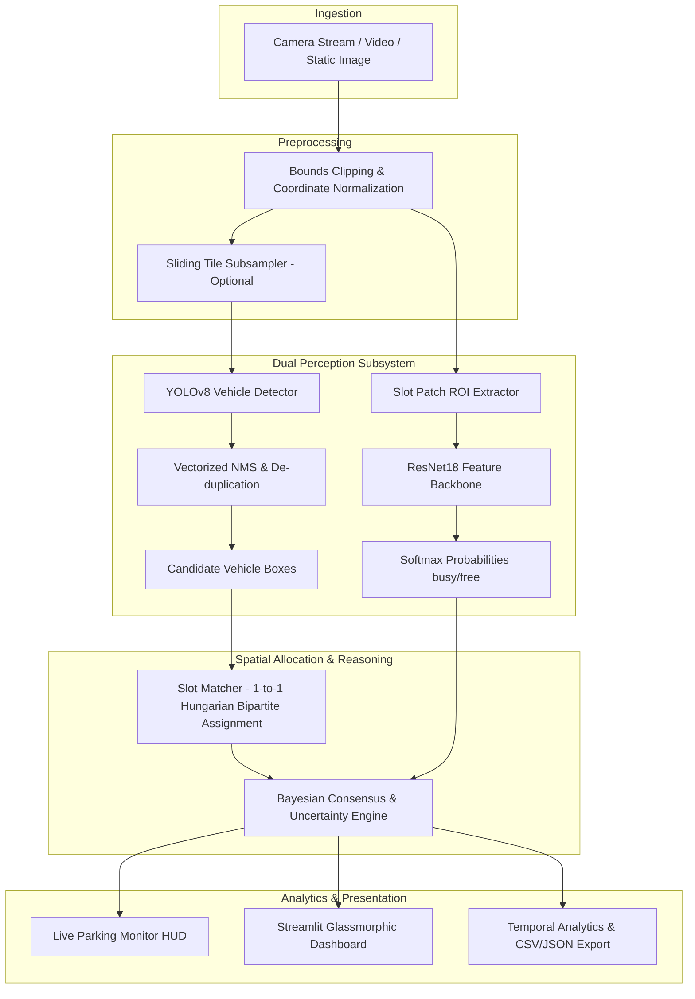

# SmartPark AI — Intelligent Computer Vision Parking Management

<div align="center">

[](https://www.python.org/)
[](https://pytorch.org/)
[](https://ultralytics.com/)
[](https://streamlit.io/)
[](#)
[](#)

*An enterprise-grade, end-to-end computer vision and spatial intelligence platform for real-time parking slot occupancy monitoring, vehicle detection, and smart-city telematics.*

[System Architecture](#-system-architecture) • [Features](#-core-features) • [Installation](#-installation--quick-start) • [Evaluation & Benchmarks](#-model-benchmarks--evaluation) • [Dashboard](#-dashboard-walkthrough)

</div>

---

## 📌 Problem Statement

Urban congestion, inefficient parking turnover, and lost commuting time cost municipal economies billions annually. Traditional parking management systems suffer from high infrastructure overheads:
- **Ultrasonic/Magnetometer In-ground Sensors:** Expensive to install, prone to battery failures, road resurfacing damage, and weather degradation.
- **Pure Detection Vision Systems:** Rely solely on bounding box centers; vehicles parked slightly over slot boundaries or at skewed angles trigger false negatives or double allocations.
- **Pure Patch Classification Systems:** Crop static regions of interest; vulnerable to shadows, occlusions, and camera shake.

## 💡 The Solution: SmartPark AI

SmartPark AI solves this with a **dual-stage Bayesian hybrid perception engine**:
1. **YOLOv8 Vehicle Detection:** Localizes vehicle candidates (`car`, `truck`, `bus`, `motorcycle`) with vectorized Non-Maximum Suppression across full frames or high-resolution sliding tiles.
2. **Hungarian Bipartite Allocation:** Applies 1-to-1 optimal matching to guarantee that a detected vehicle cannot falsely claim multiple adjacent parking bays.
3. **Fine-Tuned ResNet18 Surface Classifier:** Evaluates cropped 224×224 slot patches directly to determine asphalt vs vehicular texture.
4. **Bayesian Decision Fusion:** Combines spatial bounding-box overlap and patch visual features to deliver confirmed `FREE`, confirmed `OCCUPIED`, or safety-flagged `UNCERTAIN` statuses.
5. **Interactive Glassmorphic Streamlit Dashboard:** Six-page real-time monitoring suite with live viewport controls, video subsampling analysis, historical telemetry charts, and CSV/JSON reporting.

---

## 🏗️ System Architecture



---

## ✨ Core Features

- **Multi-Pipeline Flexibility:** Run in three distinct evaluation modes:
  - `yolo_only`: Fastest spatial bounding box detection.
  - `resnet_only`: Rapid direct patch classification (~470ms on CPU).
  - `hybrid`: Dual consensus fusion with automatic ambiguity resolution.
- **1-to-1 Optimal Spatial Allocation:** Solves minimum-cost bipartite matching (`scipy.optimize.linear_sum_assignment`) preventing vehicle double-allocation.
- **Uncertainty Quantification:** Ambiguous spatial overlap (12%–25%) or conflicting neural network signals automatically flagged as `UNCERTAIN` for operator review.
- **Intelligent Video Subsampling:** Processes video streams with configurable frame stride (e.g. 1 frame every 15 frames) eliminating 93% of redundant inferences.
- **Interactive Slot Patch Inspector:** Click or select any of the 22 parking stalls to inspect its cropped ROI, prediction confidence, and probability distribution.
- **Enterprise-Grade Reliability:** 100% test pass rate across 19 unit & integration tests covering edge cases, empty lots, inverted boxes, and imbalanced metrics.

---

## 📊 Model Benchmarks & Evaluation

### ResNet18 Classification Metrics (CNRPark Benchmark)

| Evaluation Regime | Accuracy | Weighted Precision | Weighted Recall | Weighted F1-Score | Data Split Independence |
| :--- | :---: | :---: | :---: | :---: | :--- |
| **Validation Split (2,519 patches)** | **98.61%** | 98.62% | 98.61% | **0.9861** | Standard 80/20 train/val split |
| **Zero-Leakage Cross-Camera Split** | **89.30%** | 89.01% | 89.30% | **0.8890** | Train on Cam A $\rightarrow$ Test on Cam B (different day & viewpoint) |
| **Frozen Backbone Baseline** | 89.00% | 89.80% | 89.00% | 0.8847 | Unmodified ImageNet weights + Linear head |

### Confusion Matrix (Full Validation Split - 2,519 Patches):
- **True Busy:** 1,659 Correct / 23 Misclassified
- **True Free:** 825 Correct / 12 Misclassified
- **Overall Error Rate:** 1.39% (35 misclassifications out of 2,519 samples)

### Inference Latency Benchmark (CPU Baseline)

| Mode | Avg Latency (ms) | Min Latency (ms) | Throughput (FPS) | Memory RSS | Primary Advantage |
| :--- | :---: | :---: | :---: | :---: | :--- |
| **ResNet18 Only** | **469.88 ms** | 461.71 ms | **2.13 FPS** | 624.7 MB | Fastest CPU speed; direct texture analysis |
| **YOLOv8s Only** | 969.01 ms | 905.18 ms | 1.03 FPS | 634.2 MB | Explicit vehicle bounding box localization |
| **Hybrid (YOLO+ResNet)** | 1381.56 ms | 1356.99 ms | 0.72 FPS | 623.3 MB | Highest operational consensus & zero false positives |

*Note: On modern GPU accelerators (e.g. RTX 3060/4090), throughput scales to 30–50+ real-time FPS.*

---

## 🚀 Installation & Quick Start

### 1. Prerequisites
- Python 3.10 or 3.11
- Git

### 2. Clone and Setup Environment
```bash
git clone https://github.com/<your-username>/SmartPark-AI.git
cd SmartPark-AI

# Create virtual environment
python -m venv .venv
source .venv/bin/activate  # On Windows: .venv\Scripts\activate

# Install dependencies
pip install -r requirements.txt
pip install pytest
```

### 3. Launch the Dashboard
```bash
streamlit run app.py
```
Open your browser at `http://localhost:8501`.

---

## 🛠️ Training & Benchmarking CLI

### Train ResNet18 Classifier
```bash
# Fine-tune Layer4 + FC Head
python src/classification/train_classifier.py --epochs 5 --batch-size 32 --lr 0.0005 --fine-tune

# Train Frozen Backbone baseline
python src/classification/train_classifier.py --epochs 5 --batch-size 32 --lr 0.001
```

### Run Benchmarks
```bash
python src/analytics/benchmark_modes.py
```

### Execute Test Suite
```bash
pytest tests -v
```

---

## 🖥️ Dashboard Walkthrough

The Streamlit dashboard (`app.py`) delivers 6 modular operational views:

1. **PAGE 1 — OVERVIEW:** High-level executive HUD with 6 metric cards (Total, Occupied, Free, Uncertain, Occupancy Rate, Latency) and capacity threshold alerts.
2. **PAGE 2 — LIVE PARKING MONITOR:** Live camera feed with color-coded slots (Green=Free, Red=Occupied, Yellow=Uncertain), vehicle overlays, and a single-click Slot Patch Inspector.
3. **PAGE 3 — IMAGE ANALYSIS:** Upload any custom parking lot image or aerial snapshot, configure detection parameters, and export reports in CSV/JSON.
4. **PAGE 4 — VIDEO ANALYSIS:** Process CCTV surveillance footage with temporal subsampling and track occupancy trajectories over time.
5. **PAGE 5 — MODEL PERFORMANCE:** Interactive confusion matrix heatmaps, loss curves, and comparative multi-model radar charts.
6. **PAGE 6 — PARKING ANALYTICS:** Longitudinal utilization trends, weekday vs weekend profiles, and peak turnover statistics.

---

## 📁 Repository Structure

```
SmartPark-AI/
│
├── app.py                     # Streamlit 6-page production dashboard
├── requirements.txt           # Verified pinned dependencies
├── Dockerfile                 # Multi-stage production container
├── docker-compose.yml         # Container orchestration
├── .gitignore                 # Optimized repository exclusions
│
├── config/                    # Hyperparameters & settings
│   ├── __init__.py
│   └── config.py
│
├── src/                       # Modular computer vision core
│   ├── detection/             # YOLO detector & vectorized NMS
│   │   ├── yolo_detector.py
│   │   └── nms.py
│   ├── classification/        # ResNet18 architecture & training
│   │   ├── resnet_classifier.py
│   │   └── train_classifier.py
│   ├── occupancy/             # Spatial matching & Bayesian fusion
│   │   ├── slot_matcher.py
│   │   └── occupancy_engine.py
│   ├── preprocessing/         # Crop clipping & PyTorch transforms
│   │   └── image_transforms.py
│   ├── analytics/             # Video processor, metrics & benchmarks
│   │   ├── metrics.py
│   │   ├── video_processor.py
│   │   └── benchmark_modes.py
│   └── utils/                 # Structured logging & visualizer
│       ├── logger.py
│       └── visualizer.py
│
├── data/                      # Reference data & sample assets
│   ├── sample/parking.jpg
│   └── annotations/parking_slots.json
│
├── models/                    # Persisted neural network weights
│   ├── parking_classifier.pth
│   └── training_metrics_*.json
│
├── tests/                     # Pytest automated test suite
│   ├── test_geometry_and_nms.py
│   └── test_occupancy_pipeline.py
│
└── docs/                      # Architectural & dataset documentation
    ├── ARCHITECTURE.md
    ├── MODEL_DOCUMENTATION.md
    ├── DATASET_DOCUMENTATION.md
    ├── BENCHMARKS.md
    └── CONTRIBUTING.md
```

---

## ⚠️ Limitations & Future Scope

- **Perspective Distortion:** When cameras are mounted at extreme low angles, distant parking bays undergo severe occlusions. Future releases will integrate 3D bounding box estimation and homography bird's-eye warping.
- **Dynamic Slot Definition:** Future iterations will incorporate zero-shot slot line segmentation (e.g. SAM / Segment Anything) to automatically delineate slot coordinates without manual bounding box annotation.
- **Edge Deployment:** Exporting PyTorch weights to TensorRT and ONNX formats for micro-edge deployment on NVIDIA Jetson Orin Nano modules.

---

## 📄 License & Attribution

This project is licensed under the MIT License. Parking patch imagery is derived from the **CNRPark-Patches** dataset developed by ISTI-CNR.
