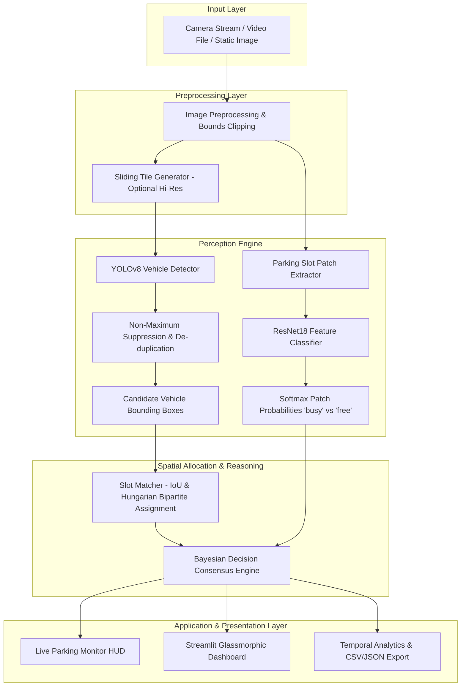
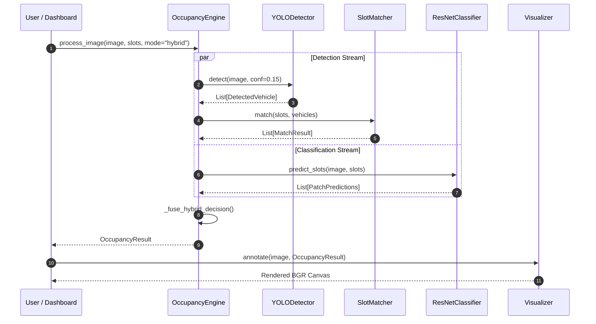

# SmartPark AI — System Architecture & Design Specification

## 1. High-Level Architecture Overview

SmartPark AI is architected as an industrial-grade, modular computer vision and analytics pipeline designed for real-time parking space surveillance. The platform bridges coarse-grained spatial object detection (YOLOv8) with fine-grained patch texture classification (ResNet18) via a bipartite optimal matching layer and a Bayesian decision consensus engine.

---

## 2. Component Design & Responsibilities

### 2.1 Configuration Layer (`config/config.py`)
- Centralized dataclasses for `DetectionConfig`, `ClassificationConfig`, `SlotMatchingConfig`, `OccupancyConfig`, and `UIConfig`.
- Decouples hyperparameters (thresholds, resolutions, learning rates, device flags) from business logic.

### 2.2 Preprocessing (`src/preprocessing/image_transforms.py`)
- **`clip_box_to_image`:** Mathematically guarantees coordinates lie within image boundaries `[0..W, 0..H]`.
- **`extract_slot_patch`:** Safe ROI crop with automatic dimensional normalization and RGB conversion.
- **`get_training_transforms`:** PyTorch augmentation pipeline (RandomHorizontalFlip, RandomRotation(15°), ColorJitter, ImageNet normalization).

### 2.3 Detection Subsystem (`src/detection/`)
- **`YOLODetector`:** Thin, performant wrapper around Ultralytics YOLOv8. Supports full-image single-shot inference or sliding-tile inference for wide-angle panoramic cameras.
- **`nms.py`:** Fast vectorized Non-Maximum Suppression to remove boundary-straddling duplicates from overlapping tiles.

### 2.4 Classification Subsystem (`src/classification/`)
- **`build_resnet18`:** Torchvision ResNet18 backbone with a custom 2-class linear output head.
- **`ResNetClassifier`:** Batch-evaluates cropped slot patches in a single forward pass on CPU/GPU.
- **`train_classifier.py`:** Automated training pipeline featuring `ReduceLROnPlateau` scheduling, early stopping, class-weighted cross-entropy loss, and checkpoint saving.

### 2.5 Occupancy & Matching Engine (`src/occupancy/`)
- **`SlotMatcher`:** Solves spatial allocation between detected vehicles and predefined parking slots:
  - **IoU:** $\frac{\text{Area}(V \cap S)}{\text{Area}(V \cup S)}$
  - **Slot Coverage:** $\frac{\text{Area}(V \cap S)}{\text{Area}(S)}$
  - **Bipartite Optimal Matching:** Employs the Hungarian algorithm (`scipy.optimize.linear_sum_assignment`) with cost matrix $C_{ij} = -\text{Affinity}(S_i, V_j)$ to enforce **1-to-1 matching** and prevent a single vehicle from occupying multiple bays.
- **`OccupancyEngine`:** Fuses spatial matches with ResNet18 patch probabilities. Handles edge cases (e.g. slight boundary overlap vs full car presence) and labels ambiguous spaces as `UNCERTAIN`.

### 2.6 Analytics & Video Processing (`src/analytics/`)
- **`VideoProcessor`:** Sub-samples video streams at configurable frame intervals (e.g. 1 frame every 15 frames) to avoid redundant CPU/GPU cycles.
- **`metrics.py`:** Computes multi-class classification and occupancy performance metrics.

---

## 3. Data Flow Diagram

