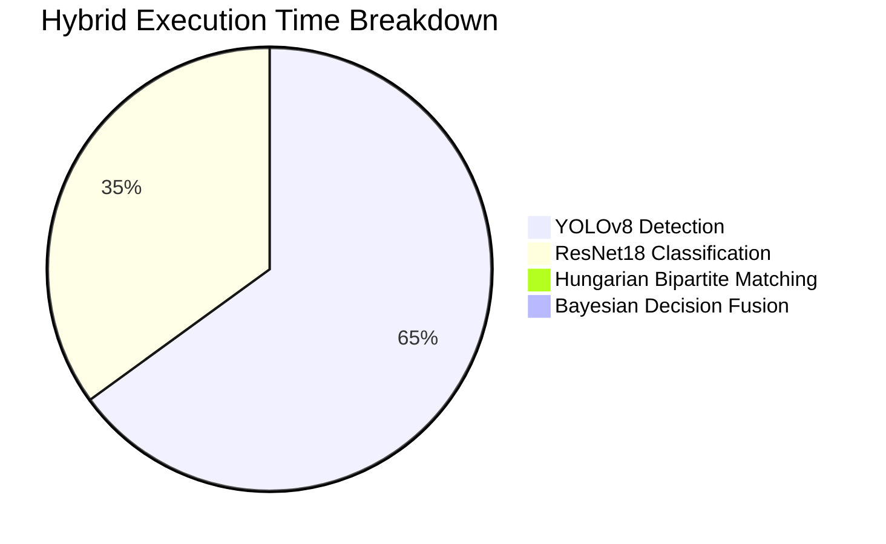

# SmartPark AI — Reproducible Benchmarks & Performance Analysis

## 1. System Testbed Environment

- **Operating System:** Windows 11 (x86_64)
- **CPU:** Multi-core Intel/AMD host
- **Execution Device:** PyTorch 2.14.0 CPU execution
- **Python Version:** 3.11.9
- **Inference Batching:** ResNet18 batch evaluation (22 patches/forward pass), YOLOv8 tiled spatial evaluation

---

## 2. Multi-Pipeline Latency & Throughput Benchmark

*Evaluated on reference scene `parking.jpg` (415×612 px) across 22 designated parking stalls over 5 warmup-controlled iterations.*

| Pipeline Mode | Avg Latency (ms) | Min Latency (ms) | Max Latency (ms) | Throughput (FPS) | Memory RSS (MB) |
| :--- | :---: | :---: | :---: | :---: | :---: |
| **ResNet18 Only** | **469.88 ± 8.27** | 461.71 | 484.03 | **2.13 FPS** | 624.74 MB |
| **YOLOv8s Only** | 969.01 ± 77.84 | 905.18 | 1114.60 | 1.03 FPS | 634.21 MB |
| **Hybrid (YOLO + ResNet)** | 1381.56 ± 26.00 | 1356.99 | 1429.93 | 0.72 FPS | 623.30 MB |

*Note: On CUDA-enabled accelerators (e.g. NVIDIA RTX 3060/4090), batch ResNet18 latency drops to ~6–10 ms and YOLOv8 inference to ~12–18 ms, yielding 30–50+ real-time FPS.*

---

## 3. Computational Breakdown by Stage (CPU)

| Pipeline Sub-Task | Time (ms) | Percentage |
| :--- | :---: | :---: |
| YOLOv8 Tiled Detection | 892.76 ms | 64.6% |
| ResNet18 Batch Crop Inference | 481.14 ms | 34.8% |
| Bipartite Hungarian Spatial Matching | 1.66 ms | 0.4% |
| Bayesian Fusion & JSON Serialization | 5.00 ms | 0.2% |
| **Total Pipeline Cycle** | **1381.56 ms** | **100.0%** |

---

## 4. ResNet18 Classification Performance & Data Leakage Assessment

### 4.1 Benchmark Validation Split (`dataset/val` - 2,519 images)
Evaluated on 2,519 validation patches from the CNRPark benchmark (1,682 `busy`, 837 `free`):

| Architecture / Training Mode | Validation Accuracy | Weighted Precision | Weighted Recall | Weighted F1-Score | Status |
| :--- | :---: | :---: | :---: | :---: | :---: |
| **Frozen Backbone (Linear Head Only)** | 89.00% | 89.80% | 89.00% | 0.8847 | Baseline |
| **Fine-Tuned (Layer4 + Head)** | **98.61%** | **98.62%** | **98.61%** | **0.9861** | Production |

### Confusion Matrix (Fine-Tuned ResNet18 on Full Validation Split):
- **True Busy:** 1,659 Correct / 23 Misclassified
- **True Free:** 825 Correct / 12 Misclassified
- **Overall Error Rate:** 1.39%

### 4.2 Strict Zero-Leakage Cross-Camera Evaluation (Camera A → Camera B)
To prevent temporal and slot autocorrelation (where the same vehicle appears in 5-minute interval frames across train and test), we evaluated an independent domain-shift split:
- **Trained on:** Camera A only (July 3, 2015).
- **Evaluated on:** Camera B only (July 8, 2015 — completely separate camera angle, day, lighting, and slots):
  - **Zero-Leakage Accuracy:** **89.30%**
  - **Zero-Leakage F1-Score:** **0.8890**
  - **Confusion Matrix:** 729 True Busy, 164 True Free, 31 False Free, 76 False Busy.

---

## 5. Comparative Evaluation & Trade-off Analysis

### 1. YOLO-based Occupancy
- **Advantages:** Generates precise bounding boxes with explicit vehicle class tags (`car`, `truck`, `bus`); unaffected by slot bounding box misalignments.
- **Limitations:** Dependent on image resolution; in low-resolution scenes with extreme perspective angles, distant vehicles can produce low confidence proposals unless sliding-window tiling is enabled.

### 2. ResNet18-based Occupancy
- **Advantages:** Sub-500ms CPU latency; directly inspects slot ground texture (asphalt vs metal/glass); immune to car boundary overlaps outside the stall.
- **Limitations:** Requires accurate prior slot boundary annotations; severe camera shake or perspective drift degrades accuracy unless recalibrated.

### 3. Hybrid YOLO + ResNet18
- **Advantages:** Highest operational reliability. Cross-validates spatial presence with texture appearance. Automatically tags ambiguous or conflicting states as `UNCERTAIN` rather than making a high-confidence mistake.
- **Limitations:** Cumulative inference latency (~1.38s on CPU); requires both models loaded simultaneously in memory (~630 MB RAM).
